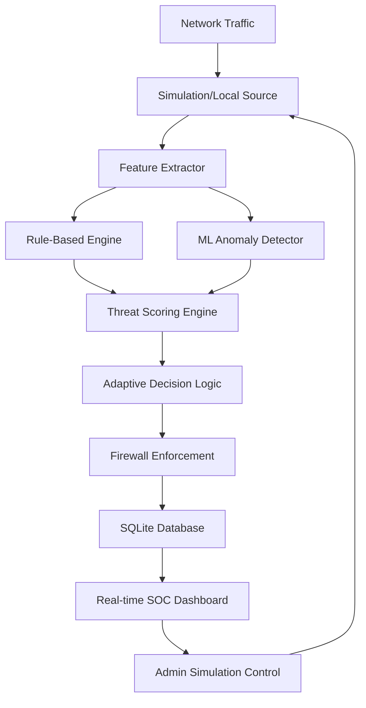

# Adaptive Firewall: Intelligent Network Security System

An academic-grade cybersecurity project implementing a real-time, adaptive firewall that utilizes rule-based detection and unsupervised machine learning to mitigate network threats dynamically.

## 🚀 Overview

The **Adaptive Firewall** is designed to move beyond static IP blocking. It monitors network traffic, extracts behavioral features, and calculates a dynamic threat score. Based on this score, the system adapts its response in real-time—scaling from simple monitoring to temporary blocking.

### The "Adaptive" Solution
Unlike traditional firewalls, this system uses a multi-layered decision engine:
1. **Rule-Based Layer**: Detects known patterns (e.g., Port Scanning, Connection Bursts).
2. **ML Layer**: Uses an **Isolation Forest** model to detect anomalies that rules might miss.
3. **Adaptive Action**: The firewall changes its enforcement (ALLOW $\to$ MONITOR $\to$ RATE_LIMIT $\to$ BLOCK) based on the aggregated threat score.

---

## 🛠️ Quick Start (macOS)

### 1. Backend Setup
```bash
# Navigate to project root
cd "Adaptive FireWall"

# Setup virtual environment
python3 -m venv venv
source venv/bin/activate

# Install dependencies
pip install -r backend/requirements.txt

# Start the server
uvicorn backend.app.main:app --host 0.0.0.0 --port 8000
```

### 2. Frontend Setup
```bash
# Open a new terminal tab
cd "Adaptive FireWall/frontend"

# Install dependencies
npm install

# Start the dashboard
npm run dev
```

**Access the Dashboard:** Open `http://localhost:3000` in your browser.

---

## 🎓 How to Demo (The Golden Path)

Follow these steps to demonstrate the system's intelligence:

1. **Baseline**: Start the application. Ensure the dashboard shows **"SYSTEM HEALTHY"** and **"NORMAL"** traffic.
2. **Trigger Attack**: In the "Traffic Simulation" panel, select **PORT SCAN**.
3. **Observe Detection**: 
   - Watch the **Live Traffic Volume** chart spike.
   - See a new **Security Alert** appear (e.g., "Suspicious Activity: HIGH").
   - Observe a new **Adaptive Rule** created for the attacker's IP with a `TEMPORARY_BLOCK` action.
4. **Verification**: Click on the rule to see the human-readable reason (e.g., "High number of unique destination ports").
5. **Adaptive Recovery**: Wait for the rule to expire (or use "Reset Demo"). Observe the rule disappearing and the source IP returning to a "Low" threat status.

---

## 🏗️ System Architecture



## 📜 License

This project is licensed under the MIT License - see the [LICENSE](LICENSE) file for details.
